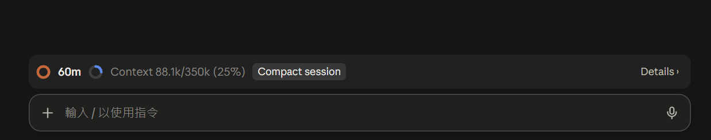
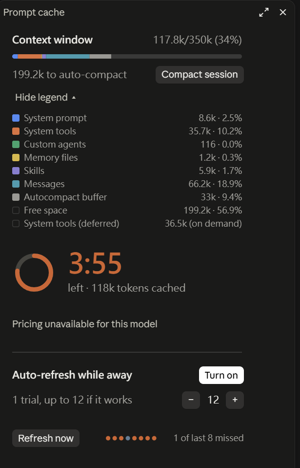

# cache-context

A Claude Code mod that shows when your conversation's prompt cache expires and what rebuilding it would cost. It can also refresh the cache for you while you are away: that is off by default, and each refresh uses a little of your plan usage or API credit.

Claude Code reuses the cached part of your conversation at a fraction of the input price. The cache entry lives for five minutes or one hour after it was last used. Come back after that and your next message writes the conversation to the cache again, at 1.25 to 2 times the normal input price. This mod puts that clock where you can see it and does the arithmetic for you.

It is a fork of [olddonkey/cache-refresher](https://github.com/olddonkey/cache-refresher) 0.2.2 that also shows how full the context window is: see [What this fork adds](#what-this-fork-adds).

[中文說明](#中文說明)

## What you get

- **A status bar above the prompt**: a ring that drains with the time left, and the countdown.
- **A panel** (`/cache-panel`, or "Details ›" on the status bar): the countdown, how many tokens are cached, the cost of an expiry next to the cost of one refresh, the break-even point, the auto-refresh switch with its limit, a "Refresh now" button and whether recent requests hit the cache.
- **Auto-refresh**, off by default: shortly before the cache would expire, the mod sends one small request that reads the cache, which restarts its lifetime. It stops at the limit you set. When the model's price is known, it also stops before the refreshes would cost more than one expiry adds. Until a refresh has been seen to extend the cache, it sends only one per idle period.
- **43 languages**, the same set the Claude desktop app ships. The mod matches the language Claude is replying in; `/cache-lang` sets one. Apart from English and Chinese the translations are machine-made and have not been checked by native speakers: corrections are welcome as issues or pull requests.

On the desktop app the ring and the panel are drawn and animated. In the terminal the same information is drawn in text.

## Commands

| Command | What it does |
| :- | :- |
| `/cache-status` | Prints the cache's status, its lifetime and the source of that lifetime, and the cost figures |
| `/cache-panel` | Opens the panel |
| `/cache-ping [force]` | Refreshes the cache now. Refused when the cache has already expired, unless `force` |
| `/cache-auto [on\|off] [max]` | Shows or changes the auto-refresh settings: on or off, and the maximum refreshes per idle period (default 12) |
| `/cache-lang [auto\|code]` | Sets the display language by its code (for example `ja`, `de`, `pt-BR`), or goes back to matching the conversation |

## Examples

- **See what stepping away costs.** After a long turn, run `/cache-status`. It prints how long the cache has left, how many tokens it holds, and what rebuilding them would cost next to the cost of one refresh.
- **Keep the cache active over lunch.** Run `/cache-auto on 12`, or open `/cache-panel` and press "Turn on". The panel shows the count as `0/1` until a refresh has been seen to work and then up to your limit, and estimates how long the cache can be kept. Your next message resets the count.
- **Extend the cache before a meeting.** Run `/cache-ping`, or press "Refresh now" in the panel. The reply says how many tokens were read from the cache and what the refresh cost, and the countdown starts over.

## The arithmetic

A refresh reads the cached prefix at the cache-read price `r`, plus a few dozen tokens for the request itself. After an expiry the prefix is written again at the cache-write price `w`, which is `w − r` more than a hit would have cost. Refreshes are worth sending while their total stays under that difference, which gives at most about `(w − r) / r` refreshes in a row, and a refresh pays off whenever the chance you come back within its window is above about `r / (w − r)`. For most models that is a few percent. `/cache-status` shows both numbers for your model and cache size.

Which lifetime applies is read from the environment variables Claude Code itself honors (`FORCE_PROMPT_CACHING_5M`, `CLAUDE_CODE_PROMPT_CACHE_TTL`, `ENABLE_PROMPT_CACHING_1H`). With none of them set, the mod assumes one hour on a subscription inside its plan limits and five minutes elsewhere. When Claude Code itself gives the lifetime (at a model switch, and on a resume that comes between five minutes and an hour after the last response), the mod uses that in place of its own assumption, except past the plan's limits. Either way it corrects the lifetime from what it observes.

Dollar figures are computed at API list prices. On a subscription they are an equivalent, not a charge.

## What this fork adds

With Claude Code 2.1.295 in the desktop app, the usage popover in my local sessions stopped showing the context window. This fork brings it back next to the cache countdown:

- **A second ring on the status bar**, filled with the share of the context window in use, followed by the figures: `Context 182.6k/350k (52%)`. To keep the bar to one line, the cache's token count, rebuild cost and auto-refresh count move into the panel.
- **A compact button** on the status bar and in the panel. It does what `/compact` does, and is hidden while Claude is replying.
- **A context section at the top of the panel**, modelled on the desktop app's own popover: a segmented bar by category, the tokens left before auto-compaction, and a legend with each category's tokens and share. Under the legend, the MCP tools, memory files and custom agents in context are listed; ↗ opens a memory file or agent in your default app.

The figures are the ones `/context` shows, read locally after each main-conversation turn; no request is sent for them.

The status bar, with the cache countdown, the context fill and the compact button:



The panel, with the context section and its legend open above the cache panel:



## What it reads, stores and sends

- **Sends**: a refresh is a request to the same model over your conversation's existing prefix, made through Claude Code (`$.model.fork`). It goes where your messages already go and nowhere else. It is sent only when you press "Refresh now", run `/cache-ping`, or have turned auto-refresh on. **Refreshes use your plan's usage or your API credit**, a little each: the cached prefix at the read price plus a few dozen tokens. A compaction is sent only when you press the compact button.
- **Reads**: the token usage of each main-conversation response; the session's context usage by category; the text of each main-conversation reply as it passes, only to count its Chinese and Latin letters; the environment variables `FORCE_PROMPT_CACHING_5M`, `CLAUDE_CODE_PROMPT_CACHE_TTL`, `ENABLE_PROMPT_CACHING_1H`, `LANG`, `LC_ALL`, and `USERPROFILE` or `HOME`; and your plan's rate-limit usage, to tell which lifetime applies. Of your files it only checks that a custom agent's file exists, to offer opening it. It does not read your settings files, your saved transcript or any credential.
- **Stores**, in the plugin's own local store: up to 100 records of cache activity (time, token counts, model, hit or miss), whether a refresh has been seen to extend the cache, the language Claude last replied in, and a language you set yourself. No message text is stored.
- No network requests of its own, no telemetry, no dependencies. The only command it runs opens a memory file or custom agent in your default app when you press its ↗.

## What each hook does

The mod registers these hooks. None of them changes what Claude is sent or what it answers.

| Hook | What it does | What it changes |
| :- | :- | :- |
| `session.start` | Starts a one-second timer that redraws the countdown and sends a refresh when one is due, registers the five commands, and measures the context window | Nothing: the event is passed on as it came |
| `session.measure` | Measures the context window again whenever Claude Code does | Nothing: the event is passed on as it came |
| `turn.step` | For the main conversation only, reads the finished step's token usage and counts the letters of its reply | Nothing: every chunk and the result are passed on untouched |
| `classic.SessionStart` | On resume or fork, takes the time since the last response, the context size, the model and whether Claude Code counts the cache as expired, so the cache's state shows before the first turn; after compaction, forgets the old cache | Nothing: it adds no context and passes the event on |
| `classic.PostModelSwitch` | Takes the cache lifetime Claude Code reports with the switch, and marks the tracked cache as no longer usable when the model changes | Nothing |
| `command.run` | Answers its own five commands, matched by name | Only those commands; no other command reaches it |
| `ui.render` (`AbovePrompt`) | Adds the one-line status bar under what is already above the prompt | Adds its own line; leaves the rest as it was, and stands aside while a survey is shown |
| `ui.render` (`Pane`, id `cache`) | Draws the mod's own panel | Only its own panel |

## Requirements and limits

- Claude Code **v2.1.287 or later**: this plugin is a [mod](https://code.claude.com/docs/en/plugins/mods/overview). The mods API is new and may change.
- Auto-refresh is per session and starts off. Until the mod has seen a refresh actually extend the cache, it sends one refresh per idle period and no more.
- Only the main conversation is tracked. Subagents keep caches of their own.
- After compaction the mod starts tracking afresh, and after a model switch it shows the cache as unavailable: what was cached no longer matches.
- The context section's own words exist in Traditional Chinese, Simplified Chinese and English; other languages show the English.

## Install

```
/plugin install cache-context --marketplace rayyichen310/cache-context
```

Type it at the prompt of a terminal session (`claude`); answer `y` to add the marketplace, then choose a scope. Once installed at the user scope it also loads in the desktop app's Code tab.

If you also have cache-refresher installed, disable it (`claude plugin disable cache-refresher@olddonkey`): both draw a status bar and register the same commands.

To try it for one session from a checkout:

```bash
claude --plugin-dir .
```

## Troubleshooting

- **No status bar above the prompt.** It appears after the first response of a session, and only once at least 1,024 tokens are cached. Check that `claude --version` is 2.1.287 or later and that `claude plugin list` shows the plugin enabled.
- **The countdown uses the wrong lifetime.** `/cache-status` shows the lifetime in force and where it came from (environment, observed or assumed). An assumed lifetime corrects itself the first time a gap longer than five minutes ends in a hit or a miss.
- **A refresh was refused, or reported a miss.** A refused refresh sends nothing and costs nothing. A miss means the cache had already expired or no longer matched; that request was billed like any other, and your next message rebuilds the cache. `/cache-ping force` sends the request anyway, which rebuilds the cache now.
- **Auto-refresh sent one refresh and stopped.** That is the trial: the rest, up to your limit, unlocks once a refresh has been seen to extend the cache.
- **The panel is in the wrong language.** `/cache-lang` followed by a language code sets one (`/cache-lang xx` lists the codes); `/cache-lang auto` goes back to matching the conversation. Closely related languages can be mistaken for one another on a short reply.
- **No ring in the terminal.** The terminal draws the same information as text; the ring and the animations are the desktop app's.

## Support

Questions and bugs about this fork: open an issue at https://github.com/rayyichen310/cache-context/issues. The cache features are cache-refresher's: https://github.com/olddonkey/cache-refresher/issues.

## Develop

```bash
claude plugin validate .
```

```bash
claude plugin test
```

`hooks/register.tsx` wires the hooks; `hooks/model.ts` and `hooks/economics.ts` are pure logic; `hooks/views.ts` draws the status bar and the panel; `hooks/messages.ts` holds the languages; `hooks/context.ts` holds the context window's figures, words and drawings.

Each language is one file under `hooks/locales/` plus an entry in the registry in `hooks/messages.ts`; `tests/locales.test.ts` holds every catalog to the English shape and to the room each panel line has. `tests/context.test.ts` covers what this fork adds.

## 中文說明

一個 Claude Code mod：顯示目前對話的提示快取還有多久過期、過期後重建大約要花多少錢。還可以在你離開時自動續期：這個功能預設關閉，每次續期會用掉少量方案額度或產生 API 費用。

- **輸入框上方的狀態列**：隨時間變短的圓環和倒數。
- **面板**（`/cache-panel` 或狀態列上的「詳情 ›」）：倒數、已快取的 token 數、過期重建與續期一次的成本對比、損益平衡點、自動續期開關與次數上限、「立即續期」按鈕和最近幾次請求的快取命中情況。
- **自動續期**預設關閉，以工作階段為單位。開啟後會在快取快過期時送一次續期請求，次數不超過你設的上限；已知模型價格時，總成本也不會超過一次過期多花的錢。確認續期有效之前，每段閒置期間只續期 1 次。
- 支援 43 種語言（和 Claude 桌面 app 一致），預設跟隨對話語言；也可以用 `/cache-lang` 加語言代碼手動設定。中英文以外的譯文是機器翻譯，沒有母語者校對，歡迎指正。
- 續期請求透過 Claude Code 送到目前的模型，內容是現有對話的前綴；除此之外不發任何網路請求，也沒有遙測。只在每則回覆經過時統計中英文字元來判斷語言，不儲存回覆內容，也不讀取設定檔、對話紀錄或任何憑證。

**這個分支多了什麼**：從 [olddonkey/cache-refresher](https://github.com/olddonkey/cache-refresher) 0.2.2 改來。桌面 app 搭配 Claude Code 2.1.295 時，本機 session 的用量彈窗不再顯示上下文視窗，所以加回來放在快取倒數旁邊：

- 狀態列多一個上下文用量的圈，例如「上下文 182.6k/350k (52%)」；快取的 token 數、重建成本和續期次數移到面板裡。
- 狀態列和面板都有壓縮按鈕，效果和 `/compact` 一樣，Claude 回應中會先藏起來。
- 面板最上方是仿桌面 app 的「背景資訊」：依類別分段的用量條、距自動壓縮剩多少、各類別的 token 數和佔比，以及 MCP 工具、記憶檔案、自訂代理清單；按 ↗ 會用預設程式打開該檔案。這是唯一會執行的指令。

截圖見上方 [What this fork adds](#what-this-fork-adds)（介面語言為英文）。

需要 Claude Code v2.1.287 及以上。安裝方式見上方 [Install](#install)；如果也裝了原版 cache-refresher，請把原版停用。

## License

MIT, as cache-refresher. See [LICENSE](LICENSE); the original copyright notice is kept.
