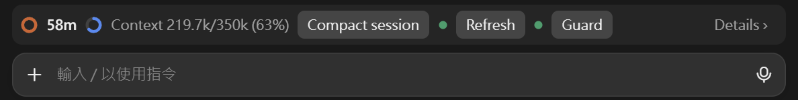
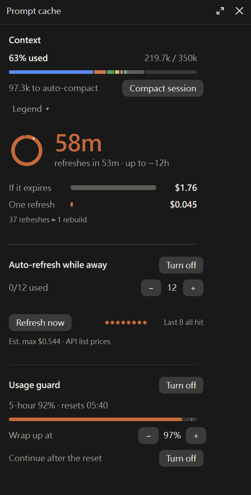

# cache-context

A Claude Code mod that shows when your conversation's prompt cache expires and what rebuilding it would cost, how full the context window is, and can pause a session near the five-hour usage limit and continue it after the reset.



[中文說明](README.zh-TW.md)

## Highlights

- **Cache countdown.** A ring above the prompt drains with the time the prompt cache has left. The panel puts the cost of letting it expire next to the cost of one refresh.
- **Context window.** A second ring shows how much of the context window is in use, and the panel breaks it down by category, as `/context` does.
- **Compact button** on the status bar and in the panel.
- **Auto-refresh**, off by default: shortly before the cache would expire, the mod sends one small request that keeps it alive. Each refresh uses a little of your plan usage or API credit.
- **Usage guard**, off by default: near the five-hour usage limit, Claude finishes the step in hand and writes down its progress, the session pauses, and it continues after the reset.
- **43 languages**, following the language Claude replies in.

On the desktop app the rings and the panel are drawn and animated. In the terminal the same information is drawn in text.

## Install

Requires Claude Code **v2.1.287 or later**. This plugin is a [mod](https://code.claude.com/docs/en/plugins/mods/overview); the mods API is new and may change.

```
/plugin install cache-context --marketplace rayyichen310/cache-context
```

Type it at the prompt of a terminal session (`claude`); answer `y` to add the marketplace, then choose a scope. Once installed at the user scope it also loads in the desktop app's Code tab.

If you also have [cache-refresher](https://github.com/olddonkey/cache-refresher) installed, disable it, since both draw a status bar and register the same commands:

```bash
claude plugin disable cache-refresher@olddonkey
```

The status bar appears after the first response of a session, once at least 1,024 tokens are cached.

## Quick start

- **See what stepping away costs.** After a long turn, run `/cache-status`. It prints how long the cache has left, how many tokens it holds, and what rebuilding them would cost next to the cost of one refresh.
- **Keep the cache active over lunch.** Run `/cache-auto on 12`, or press Refresh on the status bar. The panel shows the count as `0/1` until a refresh has been seen to work and then up to your limit, and estimates how long the cache can be kept. Your next message resets the count.
- **Extend the cache before a meeting.** Run `/cache-ping`, or press "Refresh now" in the panel. The reply says how many tokens were read from the cache and what the refresh cost, and the countdown starts over.
- **Let a long task stop cleanly at the usage limit.** Run `/cache-guard on`, or press Guard on the status bar. At 97% of the five-hour usage Claude wraps up and the session pauses until the reset.

## Commands

| Command | What it does |
| :- | :- |
| `/cache-status` | Prints the cache's status, its lifetime and the source of that lifetime, and the cost figures |
| `/cache-panel` | Opens the panel |
| `/cache-ping [force]` | Refreshes the cache now. Refused when the cache has already expired, unless `force` |
| `/cache-auto [on\|off] [max]` | Shows or changes the auto-refresh settings: on or off, and the maximum refreshes per idle period (default 12) |
| `/cache-guard [on\|off] [threshold]` | Shows or changes the usage guard: on or off, and the five-hour usage (50–99%) at which Claude wraps up. A threshold alone turns the guard on |
| `/cache-lang [auto\|code]` | Sets the display language by its code (for example `ja`, `de`, `pt-BR`), or goes back to matching the conversation |

## The status bar and the panel

The status bar is one line above the prompt: the cache ring and countdown, the context ring with its figures (`Context 182.6k/350k (52%)`), the compact button, and two toggles, Refresh for auto-refresh and Guard for the usage guard. When the bar is narrow, only the context figures are cut short.

- The dot before each toggle is green when it is on, grey when it is off, and amber while it is at work. A press turns it on or off, and both toggles stay while Claude is replying.
- While a refresh waits for the usage limit to reset, the Refresh toggle shows the reset time.
- While the guard wraps up or pauses, its toggle says so (`Guard · wrapping up 97%`, `Guard · continues 18:30`, `Guard · paused`), and a press opens the panel instead of turning the guard off.
- The compact button does what `/compact` does, and is hidden while Claude is replying.

The panel opens with `/cache-panel` or "Details ›" on the status bar. From the top: the context section, the cache countdown with its costs and the auto-refresh switch, then the usage guard.



## Prompt cache and auto-refresh

Claude Code reuses the cached part of your conversation at a fraction of the input price. The cache entry lives for five minutes or one hour after it was last used. Come back after that and your next message writes the conversation to the cache again, at 1.25 to 2 times the normal input price.

The panel shows the countdown, how many tokens are cached, the cost of an expiry next to the cost of one refresh, the break-even point, the auto-refresh switch with its limit, a "Refresh now" button, and whether recent requests hit the cache.

**When a refresh pays off.** A refresh reads the cached prefix at the cache-read price `r`, plus a few dozen tokens for the request itself. After an expiry the prefix is written again at the cache-write price `w`, which is `w − r` more than a hit would have cost. Refreshes are worth sending while their total stays under that difference, which gives at most about `(w − r) / r` refreshes in a row. A refresh pays off whenever the chance you come back within its window is above about `r / (w − r)`; for most models that is a few percent. `/cache-status` shows both numbers for your model and cache size. Dollar figures are computed at API list prices; on a subscription they are an equivalent, not a charge.

**How auto-refresh behaves:**

- It sends a refresh shortly before the cache would expire, and stops at the limit you set (12 per idle period unless you change it). When the model's price is known, it also stops before the refreshes would cost more than one expiry adds.
- Until a refresh has been seen to extend the cache, it sends only one per idle period.
- A refresh refused at the usage limit is not tried again before the reset and does not count against your limit; with no reset time given, the cache is not refreshed again until the next reply. Any other failed refresh counts as one, and the next comes at least a minute later.
- The switch and its limit are kept in the mod's own store, so they survive restarts and updates of Claude Code and apply to later sessions until you turn auto-refresh off.
- Each session's cache countdown and whether its panel was open are kept too. When a session comes back after a restart, a cache that has not yet expired is tracked and refreshed again, and the panel opens again if it was open. Records of sessions not seen for 7 days are dropped.

**Idle compaction is turned off while auto-refresh is on.** With the one-hour cache and at least 200,000 tokens of context (`CLAUDE_CODE_IDLE_COMPACT_MIN_TOKENS`, never below 100,000), Claude Code compacts an idle conversation at 90% of the cache's lifetime, 54 minutes after your last turn. Auto-refresh waits until five minutes before expiry, and a refresh does not postpone the compaction. So while any session has auto-refresh on, the mod turns Idle compaction off in your user settings, and turns it back on once no session has auto-refresh on; if the setting was already off, the mod leaves it alone. If a project, local or managed settings file holds the setting, the mod cannot change it: set `"idleCompaction": false` there, or raise `CLAUDE_CODE_IDLE_COMPACT_MIN_TOKENS` above your context size.

**Which lifetime applies** is read from the environment variables Claude Code itself honors (`FORCE_PROMPT_CACHING_5M`, `CLAUDE_CODE_PROMPT_CACHE_TTL`, `ENABLE_PROMPT_CACHING_1H`). With none of them set, the mod assumes one hour on a subscription inside its plan limits and five minutes elsewhere. When Claude Code itself gives the lifetime (at a model switch, and on a resume between five minutes and an hour after the last response that it still counts as cached, which means one hour), the mod uses that in place of its own assumption, except past the plan's limits. Either way it corrects the lifetime from what it observes.

Only the main conversation is tracked; subagents keep caches of their own. After compaction the mod starts tracking afresh, and after a model switch it shows the cache as unavailable, since what was cached no longer matches.

## Context window

The context section at the top of the panel is modelled on the desktop app's own usage popover: a segmented bar by category, the tokens left before auto-compaction, and a legend with each category's tokens and share. Under the legend, the MCP tools, memory files and custom agents in context are listed; ↗ opens a memory file or agent in your default app.

The figures are the ones `/context` shows, read locally after each main-conversation turn; no request is sent for them. The section's own words exist in Traditional Chinese, Simplified Chinese and English; other languages show the English.

## Usage guard

The guard is off until you turn it on in the panel, with the Guard toggle, or with `/cache-guard`. Once on, it works like this:

1. After each of Claude's replies, the guard reads the five-hour usage.
2. When the usage reaches the threshold (97% unless you change it, 50–99%), each tool result carries a note only Claude reads. The note asks Claude to finish the step in hand, write down its progress and the next step, and stop.
3. After 8 more tools, or at 99% usage, tools are refused. The third refused call ends the turn.
4. When the turn ends, the session is paused. Auto-refresh keeps the cache alive through the pause as usual.
5. With "Continue after the reset" on (the default), the mod sends a continue prompt 30 seconds after the five-hour reset. If that is refused, it tries again after 5 seconds, then each minute, five times at most.

While the guard wraps up or the session is paused, the panel shows the five-hour usage and the threshold, with Stop now, Not this time, Continue now and Cancel continue. "Not this time" keeps the guard quiet until the reset.

- Your own message ends a pause, even before the reset. If the usage is still over the threshold, the guard starts wrapping up again after the next reply.
- With the seven-day usage used up, there is no automatic continue.
- The guard reads the usage after each reply, so a single long reply can pass the threshold before the guard sees it.
- "Continue after the reset" is the mod's own switch. It does not change Claude Code's "Continue automatically at usage limit" (`autoContinueAtUsageLimit`): Claude Code lets a mod turn that setting off but not on.
- The guard's settings live in the panel and `/cache-guard` only. They have no `/config` row, as Claude Code does not let a mod change its own `userConfig` rows.
- The guard's words exist in Traditional Chinese and English.

## What it sends, changes and stores

- **Sends** only through your own conversation: a refresh when you ask for one or auto-refresh is on, a compaction when you press compact, and the guard's continue prompt. **Refreshes use your plan's usage or your API credit**, a little each. No network requests of its own, no telemetry, no dependencies.
- **Changes** one setting, Idle compaction, and only while auto-refresh is on. If the mod is disabled or removed while it holds the setting off, turn it back on in `/config`.
- **Stores** cache activity, its own switches and per-session state in the plugin's local store. No message text is stored, and it does not read your settings files, your saved transcript or any credential.

The full lists are in [docs/privacy.md](docs/privacy.md), and what each hook does is in [docs/hooks.md](docs/hooks.md).

## Troubleshooting

- **No status bar above the prompt.** It appears after the first response of a session, and only once at least 1,024 tokens are cached. Check that `claude --version` is 2.1.287 or later and that `claude plugin list` shows the plugin enabled.
- **The countdown uses the wrong lifetime.** `/cache-status` shows the lifetime in force and where it came from (environment, observed or assumed). An assumed lifetime corrects itself the first time a gap longer than five minutes ends in a hit or a miss.
- **A refresh was refused, or reported a miss.** A refused refresh sends nothing and costs nothing. A miss means the cache had already expired or no longer matched; that request was billed like any other, and your next message rebuilds the cache. `/cache-ping force` sends the request anyway, which rebuilds the cache now.
- **Auto-refresh sent one refresh and stopped.** That is the trial: the rest, up to your limit, unlocks once a refresh has been seen to extend the cache.
- **Auto-refresh never sent anything, and the conversation was compacted while you were away.** That is Claude Code's idle compaction; see [Prompt cache and auto-refresh](#prompt-cache-and-auto-refresh).
- **The panel is in the wrong language.** `/cache-lang` followed by a language code sets one (`/cache-lang xx` lists the codes); `/cache-lang auto` goes back to matching the conversation. Closely related languages can be mistaken for one another on a short reply. Apart from English and Chinese the translations are machine-made and have not been checked by native speakers: corrections are welcome as issues or pull requests.
- **No ring in the terminal.** The terminal draws the same information as text; the rings and the animations are the desktop app's.

Questions and bugs: open an issue at https://github.com/rayyichen310/cache-context/issues.

## Develop

To try it for one session from a checkout:

```bash
claude --plugin-dir .
```

```bash
claude plugin validate .
```

```bash
claude plugin test
```

`hooks/register.tsx` wires the hooks; `hooks/model.ts` and `hooks/economics.ts` are pure logic; `hooks/views.ts` draws the status bar and the panel; `hooks/messages.ts` holds the languages; `hooks/context.ts` holds the context window's figures, words and drawings; `hooks/limits.ts` holds the usage guard's defaults and words.

Each language is one file under `hooks/locales/` plus an entry in the registry in `hooks/messages.ts`; `tests/locales.test.ts` holds every catalog to the English shape and to the room each panel line has. `tests/context.test.ts` covers the context window, `tests/guard.test.ts` the usage guard and `tests/restart.test.ts` what is carried over a restart.

## Credits

cache-context is a fork of [olddonkey/cache-refresher](https://github.com/olddonkey/cache-refresher) 0.2.4, which provides the cache countdown, the cost figures, auto-refresh and the languages. The fork started when, with Claude Code 2.1.295 in the desktop app, the usage popover in local sessions stopped showing the context window. It adds:

- The context window: the ring on the status bar and the context section in the panel
- The compact button
- The usage guard and `/cache-guard`
- The Refresh and Guard toggles on the status bar
- The auto-refresh switch kept across restarts, and each session's cache countdown and open panel carried over a restart
- Waiting for the reset when a refresh is refused at the usage limit, instead of trying again every second

Bugs in the original cache features can also be reported to cache-refresher: https://github.com/olddonkey/cache-refresher/issues.

## License

MIT, as cache-refresher. See [LICENSE](LICENSE); the original copyright notice is kept.
