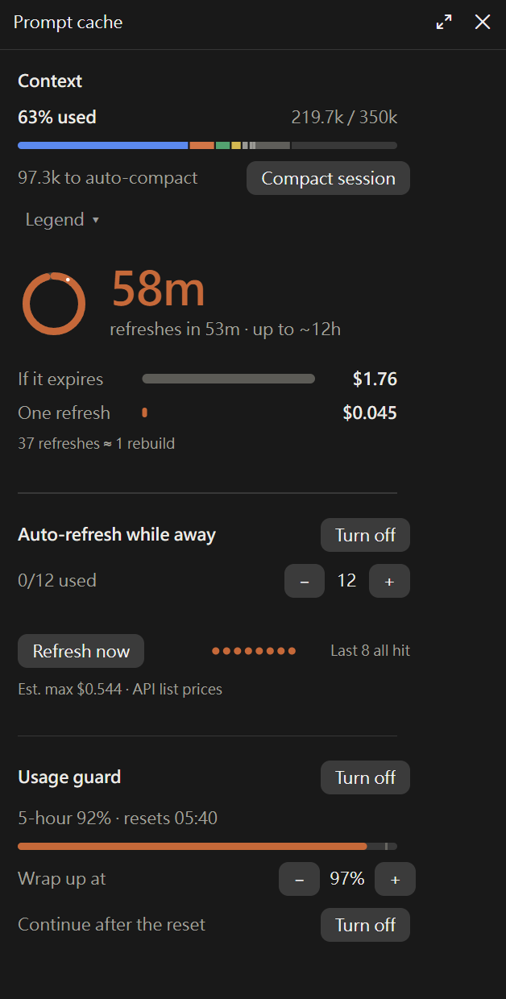

# cache-context

一個 Claude Code mod：顯示目前對話的提示快取還有多久過期、過期後重建要花多少錢，以及上下文視窗用了多少；還能在五小時用量快滿時讓工作階段收尾暫停，額度重置後自動繼續。


[English](README.md)（截圖的介面語言為英文）

## 功能重點

- **快取倒數**：輸入框上方的圓環隨快取剩餘時間變短。面板把「讓快取過期」和「續期一次」的成本並排列出。
- **上下文視窗**：第二個圓環顯示上下文視窗用了多少，面板裡依類別拆開，和 `/context` 看到的一樣。
- **壓縮按鈕**：狀態列和面板上都有。
- **自動續期**，預設關閉：快取快過期時送一個小請求讓它續命。每次續期會用掉少量方案額度或 API 費用。
- **用量保護**，預設關閉：五小時用量快滿時，Claude 做完手上這一步、寫下進度，工作階段暫停，額度重置後自動繼續。
- **43 種語言**，跟著 Claude 回覆的語言切換。

在桌面 app 裡，圓環和面板是圖形並有動畫；在終端機裡用文字顯示同樣的資訊。

## 安裝

需要 Claude Code **v2.1.287 或以上**。這個外掛是 [mod](https://code.claude.com/docs/en/plugins/mods/overview)，mods API 還很新，之後可能會變。

```
/plugin install cache-context --marketplace rayyichen310/cache-context
```

在終端機工作階段（`claude`）的輸入框輸入這行，問到是否加入 marketplace 時回答 `y`，再選安裝範圍。裝在使用者範圍時，桌面 app 的 Code 分頁也會載入。

如果也裝了原版 [cache-refresher](https://github.com/olddonkey/cache-refresher)，請把它停用，因為兩者都會畫狀態列、註冊同樣的指令：

```bash
claude plugin disable cache-refresher@olddonkey
```

狀態列會在工作階段的第一次回應之後、快取至少有 1,024 個 token 時出現。

## 快速上手

- **看看離開一下要花多少。** 一輪長回應之後執行 `/cache-status`，會列出快取還剩多久、存了多少 token，以及重建的成本和續期一次的成本。
- **午餐時間讓快取保持有效。** 執行 `/cache-auto on 12`，或按狀態列上的「續期」。確認續期有效之前，面板上的次數顯示為 `0/1`，之後上限才是你設的次數；面板也會估計快取能撐多久。你送出下一則訊息時次數歸零。
- **開會前延長快取。** 執行 `/cache-ping`，或按面板上的「立即續期」。回覆會寫出從快取讀了多少 token、這次續期花了多少，倒數重新開始。
- **讓長任務在用量上限前好好停下。** 執行 `/cache-guard on`，或按狀態列上的「保護」。五小時用量到 97% 時 Claude 會收尾，工作階段暫停到額度重置。

## 指令

| 指令 | 作用 |
| :- | :- |
| `/cache-status` | 列出快取狀態、壽命和壽命的來源，以及成本數字 |
| `/cache-panel` | 打開面板 |
| `/cache-ping [force]` | 立即續期。快取已過期時會拒絕，除非加 `force` |
| `/cache-auto [on\|off] [max]` | 顯示或修改自動續期設定：開或關，以及每段閒置期間最多續期幾次（預設 12） |
| `/cache-guard [on\|off] [threshold]` | 顯示或修改用量保護：開或關，以及五小時用量到多少（50–99%）時讓 Claude 收尾。只給門檻也會開啟保護 |
| `/cache-lang [auto\|code]` | 用語言代碼設定顯示語言（例如 `ja`、`de`、`pt-BR`），或改回跟隨對話語言 |

## 狀態列與面板

狀態列是輸入框上方的一行：快取圓環和倒數、上下文圓環和數字（`上下文 182.6k/350k (52%)`）、壓縮按鈕，以及兩個開關：「續期」管自動續期，「保護」管用量保護。寬度不夠時只截短上下文的數字。

- 開關前的圓點：綠色是開、灰色是關、橘色是正在動作。按一下切換開或關；Claude 回應中也會顯示。
- 續期在等用量上限重置時，「續期」開關會顯示重置時間。
- 用量保護收尾或暫停時，開關會寫出狀態（`保護 · 收尾中 97%`、`保護 · 18:30 繼續`、`保護 · 已暫停`），這時按下會打開面板，不會關掉保護。
- 壓縮按鈕的效果和 `/compact` 一樣，Claude 回應中會先藏起來。

用 `/cache-panel` 或狀態列上的「詳情 ›」打開面板。由上往下是：上下文區塊、快取倒數與成本和自動續期開關、用量保護。



## 提示快取與自動續期

Claude Code 會重用對話中已快取的部分，價格只有一般輸入的一小部分。快取在最後一次使用後保留 5 分鐘或 1 小時；超過時間才回來，下一則訊息就得把對話重新寫進快取，價格是一般輸入的 1.25 到 2 倍。

面板顯示倒數、已快取的 token 數、過期重建與續期一次的成本對比、損益平衡點、自動續期開關與次數上限、「立即續期」按鈕，以及最近幾次請求有沒有命中快取。

**續期什麼時候划算。** 一次續期用快取讀取價 `r` 讀一遍已快取的前綴，再加上請求本身幾十個 token。過期之後，前綴要用快取寫入價 `w` 重寫，比命中多花 `w − r`。續期的總成本低於這個差額時才值得送，所以最多連續送大約 `(w − r) / r` 次；只要你在一次續期的時間內回來的機率高於大約 `r / (w − r)`，續期就划算，大多數模型是幾個百分點。`/cache-status` 會依你的模型和快取大小算出這兩個數字。金額按 API 牌價計算；訂閱方案下是等值金額，不是實際收費。

**自動續期的行為：**

- 在快取快過期時送出續期，次數到你設的上限就停（沒改過是每段閒置期間 12 次）。已知模型價格時，在續期總成本超過一次過期多花的錢之前也會停。
- 確認續期確實能延長快取之前，每段閒置期間只續期 1 次。
- 續期遇到用量上限被拒時，等額度重置後才再試，這次不算進上限；讀不到重置時間時，等下一次回覆後才再續。其他原因失敗算一次，下一次至少隔 1 分鐘。
- 開關和次數上限存在外掛自己的儲存區，Claude Code 重開或更新後仍保持，並套用到之後的工作階段，直到你關掉。
- 每個工作階段的快取倒數和面板是否開著也會存起來。Claude Code 重開、工作階段接回來後，還沒過期的快取會繼續追蹤和續期，原本開著的面板會重新打開。7 天沒出現的工作階段紀錄會被清掉。

**自動續期開著時，閒置壓縮會被關掉。** 使用 1 小時快取且上下文達到 20 萬 token（由 `CLAUDE_CODE_IDLE_COMPACT_MIN_TOKENS` 設定，最低 10 萬）時，Claude Code 會在快取壽命的 90%，也就是最後一輪結束後第 54 分鐘，把閒置的對話壓縮成摘要。自動續期要等到過期前 5 分鐘才送，續期也不會延後壓縮。所以只要有工作階段開著自動續期，外掛就在你的使用者設定裡關掉 Idle compaction，等沒有工作階段開著自動續期時再打開；開啟自動續期時這項設定本來就關著的話，外掛不會動它。如果這項設定由專案、本機或受管設定檔決定，外掛改不了，請在那裡設定 `"idleCompaction": false`，或把 `CLAUDE_CODE_IDLE_COMPACT_MIN_TOKENS` 調到高於你的上下文大小。

**快取壽命的判斷**：先看 Claude Code 本身採用的環境變數（`FORCE_PROMPT_CACHING_5M`、`CLAUDE_CODE_PROMPT_CACHE_TTL`、`ENABLE_PROMPT_CACHING_1H`）。都沒設定時，訂閱方案在額度內假設 1 小時，其他情況假設 5 分鐘。Claude Code 自己給出壽命時（切換模型時，以及在最後一次回應後 5 分鐘到 1 小時之間恢復、而 Claude Code 仍視為已快取時，代表是 1 小時），外掛改用它的值，但超出方案額度時除外。不論哪種，外掛都會依實際觀察修正壽命。

只追蹤主對話；subagent 有自己的快取。壓縮後外掛重新開始追蹤；切換模型後快取顯示為無法使用，因為已快取的內容對不上了。

## 上下文視窗

面板最上方的上下文區塊仿照桌面 app 自己的用量彈窗：依類別分段的用量條、距離自動壓縮還剩多少 token，以及各類別的 token 數和佔比。下面列出上下文中的 MCP 工具、記憶檔案和自訂 agent；按 ↗ 會用預設程式打開該記憶檔案或 agent。

數字和 `/context` 顯示的一樣，在每輪主對話結束後從本機讀取，不會為此送出請求。這個區塊自己的文字有繁體中文、簡體中文和英文；其他語言顯示英文。

## 用量保護

用量保護預設關閉，可在面板、狀態列的「保護」開關或用 `/cache-guard` 開啟。開啟後的流程：

1. Claude 每次回覆後，讀取五小時用量。
2. 用量達到門檻（預設 97%，可設 50–99%）時，之後每個工具結果都附上一段只有 Claude 看得到的提醒，請它做完手上這一步、寫下進度和下一步，然後停下。
3. 再用 8 次工具，或用量到 99%，工具就會被擋下；第 3 次被擋就結束這一輪。
4. 這一輪結束後，工作階段進入暫停。暫停期間自動續期照常運作。
5. 「重置後自動繼續」開著時（預設開），外掛會在五小時額度重置後 30 秒送出繼續訊息；被拒時 5 秒後重試，之後每分鐘一次，最多 5 次。

收尾或暫停期間，面板顯示五小時用量和門檻，並有「立即停止」「這次不暫停」「立即繼續」「取消自動繼續」按鈕。「這次不暫停」會讓保護在這次重置前不再動作。

- 你自己送出訊息就會結束暫停，即使還沒重置。如果用量仍超過門檻，下一次回覆後保護會再次開始收尾。
- 七天用量用完時不會自動繼續。
- 保護是在每次回覆後讀取用量，所以單一一次很長的回覆可能在保護看到之前就超過門檻。
- 「重置後自動繼續」是本外掛自己的開關，不會改動 Claude Code 原生的「Continue automatically at usage limit」（`autoContinueAtUsageLimit`）：Claude Code 只讓 mod 關掉那個設定，不能打開。
- 用量保護的設定只在面板和 `/cache-guard`，`/config` 裡沒有對應的列，因為 Claude Code 不讓 mod 修改自己的 `userConfig` 列。
- 用量保護的文字只有繁體中文和英文。

## 會送出、修改和儲存什麼

- **送出**：只透過你自己的對話送出。你要求續期或開著自動續期時送續期請求，按壓縮按鈕時送壓縮，以及用量保護的繼續訊息。**續期會用掉方案額度或 API 費用**，每次一點。除此之外不發任何網路請求，沒有遙測，也沒有外部依賴。
- **修改**：只改一項設定 Idle compaction，而且只在自動續期開著時。如果在外掛關著這項設定時停用或移除外掛，請到 `/config` 手動打開。
- **儲存**：快取活動紀錄、外掛自己的開關和每個工作階段的狀態，存在外掛的本機儲存區。不儲存訊息內容，也不讀取你的設定檔、對話紀錄或任何憑證。

完整清單見 [docs/privacy.md](docs/privacy.md)，每個 hook 的作用見 [docs/hooks.md](docs/hooks.md)（英文）。

## 疑難排解

- **輸入框上方沒有狀態列。** 狀態列在工作階段第一次回應之後、快取至少有 1,024 個 token 時才出現。確認 `claude --version` 是 2.1.287 或以上，以及 `claude plugin list` 顯示外掛已啟用。
- **倒數用錯了快取壽命。** `/cache-status` 會顯示目前採用的壽命和來源（環境變數、觀察或假設）。假設的壽命會在第一次超過 5 分鐘的間隔以命中或未命中結束時自動修正。
- **續期被拒，或回報未命中。** 被拒的續期不會送出、不花錢。未命中代表快取已經過期或對不上了；那次請求照一般請求計費，你的下一則訊息會重建快取。`/cache-ping force` 會照樣送出，等於現在就重建快取。
- **自動續期送了一次就停了。** 那是試用階段：確認續期能延長快取之後，才會開放到你設的上限。
- **自動續期什麼都沒送，離開期間對話被壓縮了。** 那是 Claude Code 的閒置壓縮，見[提示快取與自動續期](#提示快取與自動續期)。
- **面板語言不對。** `/cache-lang` 加語言代碼可以指定（`/cache-lang xx` 會列出代碼），`/cache-lang auto` 改回跟隨對話。回覆很短時，相近的語言可能被認錯。中英文以外的譯文是機器翻譯，沒有母語者校對，歡迎用 issue 或 pull request 指正。
- **終端機裡沒有圓環。** 終端機用文字顯示同樣的資訊；圓環和動畫只有桌面 app 有。

問題與錯誤回報：https://github.com/rayyichen310/cache-context/issues

## 開發

從 checkout 試用一個工作階段：

```bash
claude --plugin-dir .
```

```bash
claude plugin validate .
```

```bash
claude plugin test
```

`hooks/register.tsx` 串接各個 hook；`hooks/model.ts` 和 `hooks/economics.ts` 是純邏輯；`hooks/views.ts` 畫狀態列和面板；`hooks/messages.ts` 管語言；`hooks/context.ts` 放上下文視窗的數字、文字和繪圖；`hooks/limits.ts` 放用量保護的預設值和文字。

每種語言是 `hooks/locales/` 下的一個檔案，加上 `hooks/messages.ts` 登記表裡的一筆；`tests/locales.test.ts` 檢查每份語言檔和英文的結構一致、每行面板文字放得下。`tests/context.test.ts` 測上下文視窗，`tests/guard.test.ts` 測用量保護，`tests/restart.test.ts` 測重開後接續的部分。

## 來源

cache-context 是 [olddonkey/cache-refresher](https://github.com/olddonkey/cache-refresher) 0.2.4 的 fork，快取倒數、成本數字、自動續期和多語言都來自原版。開這個 fork 的起因是：桌面 app 搭配 Claude Code 2.1.295 時，本機工作階段的用量彈窗不再顯示上下文視窗。這個 fork 多了：

- 上下文視窗：狀態列上的圓環和面板裡的上下文區塊
- 壓縮按鈕
- 用量保護和 `/cache-guard`
- 狀態列上的「續期」「保護」開關
- 自動續期開關在重開後保留，每個工作階段的快取倒數和面板狀態在重開後接續
- 續期遇到用量上限時等重置，不再每秒重試

原版快取功能的問題也可以回報給 cache-refresher：https://github.com/olddonkey/cache-refresher/issues

## 授權

MIT，與 cache-refresher 相同。見 [LICENSE](LICENSE)；保留原作者的版權聲明。
