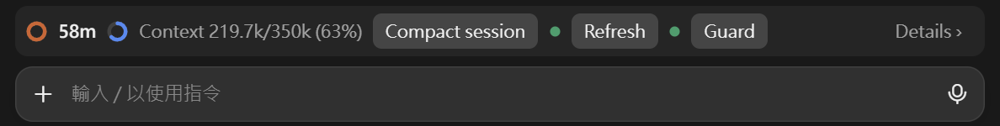
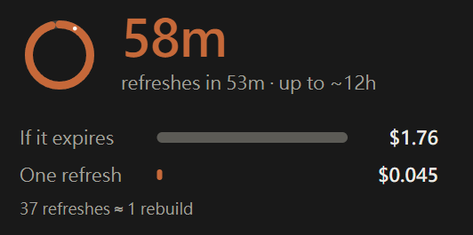
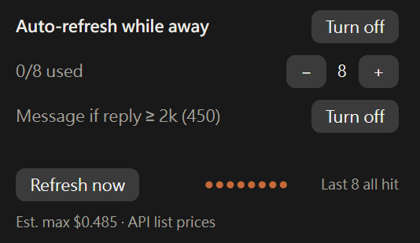
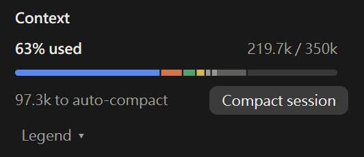
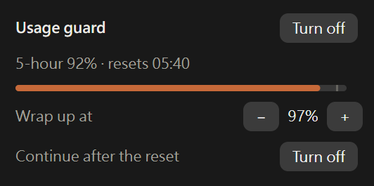

# cache-context

一個 Claude Code mod：顯示目前對話的提示快取還有多久過期、過期後重建要花多少錢，以及上下文視窗用了多少；還能在五小時用量快滿時讓工作階段收尾暫停，額度重置後自動繼續。它也能在你離開時自動續期快取：這個功能預設關閉，每次續期會用掉少量方案額度或 API 費用。



[English](README.md)（截圖的介面語言為英文）

所有資訊都在輸入框上方的一行狀態列。按狀態列上的「詳情 ›」或執行 `/cache-panel`，會打開下面各節截圖裡的面板。在桌面 app 裡，圓環和面板是圖形並有動畫；在終端機裡用文字顯示同樣的資訊。

## 看看離開一下要花多少 — 快取倒數

Claude Code 會把對話放在提示快取裡，最後一次使用後保留 5 分鐘或 1 小時。離開超過這個時間，回來的第一則訊息就得付錢把整段對話重新放進快取。每則訊息都要把前面的對話送給模型，價錢取決於快取的狀態。下表以模型的一般輸入單價為 1：

| 這則訊息怎麼處理前面的對話 | 單價 |
| :- | :- |
| 快取還在，直接從快取讀 | 0.1（大多數模型；Opus 5.5 是 0.05） |
| （對照）不用快取，當一般輸入送 | 1 |
| 快取過期，重新寫進快取 | 5 分鐘快取 1.25，1 小時快取 2 |

狀態列上的圓環隨快取剩餘時間變短。面板把「重建快取」和「續期一次保住快取」的成本並排列出：



舉例：對話約 9.2 萬 token，模型是 Opus 5.5（一般輸入每百萬 token $4），快取是 1 小時，Claude 最後一則回覆長 5 千 token。過期後重建是 9.2 萬 × $4 × 2 ≈ $0.74。續期一次要讀一遍快取，9.2 萬 × $4 × 0.05 ≈ $0.018，還會把 Claude 最後一則回覆重新寫進 5 分鐘快取，5 千 × $4 × 1.25 ≈ $0.026，加上請求本身幾十個 token，共約 $0.045。最後一則回覆短的話，續期便宜得多。

一輪長回應之後執行 `/cache-status`，可以用文字看到同樣的數字：快取還剩多久、存了多少 token，以及兩種成本。金額按 API 牌價計算；訂閱方案下是等值金額，不是實際收費。

## 午餐時間保住快取 — 自動續期

知道自己要離開一陣子時，自動續期會在快取快過期時送一個小請求讓它續命。預設關閉。**每次續期會用掉少量方案額度或 API 費用。**



- 用狀態列上的「續期」、面板上的「開啟」或 `/cache-auto on 12` 開啟。
- 次數到你設的上限就停（沒改過是每段閒置期間 12 次），續期總成本快超過重建一次時也會停。面板會估計快取能撐多久。
- 確認續期確實能保住快取之前，每段閒置期間只續期 1 次，面板上的次數顯示為 `0/1`。你送出下一則訊息時次數歸零。
- Claude Code 更新或重開後，自動續期仍然開著，還沒過期的快取會接著續期，不會因為重開就停掉。要停只能你自己關。
- 續期成功時，結果顯示在輸入框下方的狀態行，只留最新一次，你送出下一則訊息時清掉。續期失敗或沒命中快取，才會寫進對話紀錄。
- Claude 最後一則回覆很長時，每次續期都會把它重新寫進快取。開啟面板上的「回覆 ≥ 2k 時先插訊息」（或 `/cache-auto trim`）後，第一次續期改成在對話裡插一則短訊息，Claude 回「ok」；這則訊息和回覆會留在對話紀錄裡。之後長回覆就和對話一起存在快取裡，後面的續期只重寫那句「ok」。預設關閉；`/cache-auto trim 3000` 可以改門檻，面板會在開關文字後面的括號裡顯示最後一則回覆有多長。
- 開著時，外掛會關掉 Claude Code 的閒置壓縮，不然長對話會在第一次續期前就被壓縮；之後再把設定打開。

只想延長一次，例如開會前，按「立即續期」或執行 `/cache-ping`。回覆會寫出從快取讀了多少 token、這次續期花了多少，倒數重新開始。

## 知道什麼時候該壓縮 — 上下文視窗

上下文視窗滿了，Claude Code 會自己壓縮對話。狀態列上的第二個圓環顯示視窗用了多少，面板顯示離自動壓縮還有多遠：



- 依類別分段的用量條，以及距離自動壓縮還剩多少 token。
- 展開「Legend」可以看到各類別的佔比，以及上下文中的 MCP 工具、記憶檔案和自訂 agent；按 ↗ 會用預設程式打開該記憶檔案或 agent。
- 這裡和狀態列上的「壓縮工作階段」按鈕，效果和 `/compact` 一樣，由你決定什麼時候按。

## 用量用完前先停，保住快取 — 用量保護

五小時用量用完後，續期請求也會被拒，快取在等額度重置的期間過期，重置後的第一則訊息就得付重建的錢。用量保護在用完之前（預設 97%）就讓 Claude 收尾、暫停，留一點額度給自動續期，讓快取撐到重置之後。預設關閉。



- 用狀態列上的「保護」、面板上的「開啟」或 `/cache-guard on` 開啟。
- 五小時用量達到門檻（預設 97%）時，保護會請 Claude 做完手上這一步、寫下進度後停下。
- 之後工作階段暫停。五小時額度重置 30 秒後，外掛會自動替你送一則訊息，請 Claude 接著做暫停前的工作（和 Claude Code 原生的「達到用量上限後自動繼續」作用一樣）。暫停期間開著自動續期的話，快取一直保住，這則訊息不必付重建的錢。
- 你自己送出訊息，隨時可以結束暫停。

## 狀態列開關

「續期」和「保護」兩個開關用圓點表示狀態：綠色是開、灰色是關、橘色是正在動作。用量保護收尾或暫停時，開關會寫出狀態（`保護 · 收尾中 97%`、`保護 · 18:30 繼續`、`保護 · 已暫停`），這時按下會打開面板，不會關掉保護。

各功能背後的規則，例如快取壽命怎麼判斷、續期什麼時候停、用量保護的完整流程，見[運作細節](docs/how-it-works.zh-TW.md)。

## 安裝

需要 Claude Code **v2.1.287 或以上**。這個外掛是 [mod](https://code.claude.com/docs/en/plugins/mods/overview)，mods API 還很新，之後可能會變。

```
/plugin install cache-context --marketplace rayyichen310/cache-context
```

在終端機工作階段（`claude`）的輸入框輸入這行，問到是否加入 marketplace 時回答 `y`，再選安裝範圍。裝在使用者範圍時，桌面 app 的 Code 分頁也會載入。

如果也裝了原版 [cache-refresher](https://github.com/olddonkey/cache-refresher)，請把它停用，因為兩者都會畫狀態列、註冊同樣的指令：

```bash
claude plugin disable cache-refresher@olddonkey
```

狀態列會在工作階段的第一次回應之後、快取至少有 1,024 個 token 時出現。

## 指令

| 指令 | 作用 |
| :- | :- |
| `/cache-status` | 列出快取狀態、壽命和壽命的來源，以及成本數字 |
| `/cache-panel` | 打開面板 |
| `/cache-ping [force]` | 立即續期。快取已過期時會拒絕，除非加 `force` |
| `/cache-auto [on\|off] [max]` | 顯示或修改自動續期設定：開或關，以及每段閒置期間最多續期幾次（預設 12） |
| `/cache-auto trim [on\|off] [token 數]` | 開關「長回覆先插訊息」，以及最後一則回覆多長時觸發（預設 2,000 token，可設 500–200,000）。只給 token 數會同時開啟 |
| `/cache-guard [on\|off] [threshold]` | 顯示或修改用量保護：開或關，以及五小時用量到多少（50–99%）時讓 Claude 收尾。只給門檻也會開啟保護 |
| `/cache-lang [auto\|code]` | 用語言代碼設定顯示語言（例如 `ja`、`de`、`pt-BR`），或改回跟隨對話語言 |

介面跟著 Claude 回覆的語言切換，支援 43 種語言。中英文以外的譯文是機器翻譯，沒有母語者校對，歡迎用 issue 或 pull request 指正。

## 會送出、修改和儲存什麼

- **送出**：只透過你自己的對話送出。你要求續期或開著自動續期時送續期請求，開了「長回覆先插訊息」時在續期前送那則短訊息，按壓縮按鈕時送壓縮，以及用量保護的繼續訊息。**續期會用掉方案額度或 API 費用**，每次一點。除此之外不發任何網路請求，沒有遙測，也沒有外部依賴。
- **修改**：只改一項設定 Idle compaction，而且只在自動續期開著時。如果在外掛關著這項設定時停用或移除外掛，請到 `/config` 手動打開。
- **儲存**：快取活動紀錄、外掛自己的開關和每個工作階段的狀態，存在外掛的本機儲存區。不儲存訊息內容，也不讀取你的設定檔、對話紀錄或任何憑證。

完整清單見 [docs/privacy.md](docs/privacy.md)，每個 hook 的作用見 [docs/hooks.md](docs/hooks.md)（英文）。

## 疑難排解

- **輸入框上方沒有狀態列。** 狀態列在工作階段第一次回應之後、快取至少有 1,024 個 token 時才出現。確認 `claude --version` 是 2.1.287 或以上，以及 `claude plugin list` 顯示外掛已啟用。
- **倒數用錯了快取壽命。** `/cache-status` 會顯示目前採用的壽命和來源（環境變數、觀察或假設）。假設的壽命會在第一次超過 5 分鐘的間隔以命中或未命中結束時自動修正。
- **續期被拒，或回報未命中。** 被拒的續期不會送出、不花錢。未命中代表快取已經過期或對不上了；那次請求照一般請求計費，你的下一則訊息會重建快取。`/cache-ping force` 會照樣送出，等於現在就重建快取。
- **自動續期送了一次就停了。** 那是試用階段：確認續期能保住快取之後，才會開放到你設的上限。
- **自動續期什麼都沒送，離開期間對話被壓縮了。** 那是 Claude Code 的閒置壓縮。自動續期開著時外掛會關掉它，除非這項設定由專案、本機或受管設定檔決定；見[閒置壓縮](docs/how-it-works.zh-TW.md#閒置壓縮)。
- **面板語言不對。** `/cache-lang` 加語言代碼可以指定（`/cache-lang xx` 會列出代碼），`/cache-lang auto` 改回跟隨對話。回覆很短時，相近的語言可能被認錯。
- **終端機裡沒有圓環。** 終端機用文字顯示同樣的資訊；圓環和動畫只有桌面 app 有。

問題與錯誤回報：https://github.com/rayyichen310/cache-context/issues

## 開發

從 checkout 試用一個工作階段：

```bash
claude --plugin-dir .
```

```bash
claude plugin validate .
```

```bash
claude plugin test
```

`hooks/register.tsx` 串接各個 hook；`hooks/model.ts` 和 `hooks/economics.ts` 是純邏輯；`hooks/views.ts` 畫狀態列和面板；`hooks/messages.ts` 管語言；`hooks/context.ts` 放上下文視窗的數字、文字和繪圖；`hooks/limits.ts` 放用量保護的預設值和文字。

每種語言是 `hooks/locales/` 下的一個檔案，加上 `hooks/messages.ts` 登記表裡的一筆；`tests/locales.test.ts` 檢查每份語言檔和英文的結構一致、每行面板文字放得下。`tests/context.test.ts` 測上下文視窗，`tests/guard.test.ts` 測用量保護，`tests/restart.test.ts` 測重開後接續的部分。

## 來源

cache-context 是 [olddonkey/cache-refresher](https://github.com/olddonkey/cache-refresher) 0.2.4 的 fork，快取倒數、成本數字、自動續期和多語言都來自原版。這個 fork 多了：

- 用量保護和 `/cache-guard`
- 上下文視窗：狀態列上的圓環和面板裡的上下文區塊
- 壓縮按鈕
- 狀態列上的「續期」「保護」開關
- 自動續期開關在重開後保留，每個工作階段的快取倒數和面板狀態在重開後接續
- 續期遇到用量上限時等重置，不再每秒重試

原版快取功能的問題也可以回報給 cache-refresher：https://github.com/olddonkey/cache-refresher/issues

## 授權

MIT，與 cache-refresher 相同。見 [LICENSE](LICENSE)；保留原作者的版權聲明。
